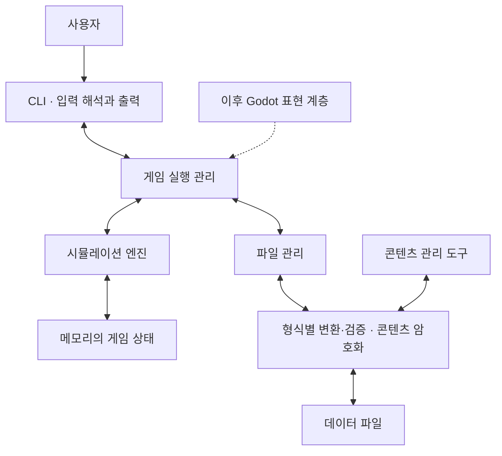

# 코드 구조와 실행 흐름

상태: 구성 요소의 책임과 실행 원칙 합의. 실제 프로젝트·폴더·클래스·메서드 분할은 미정이며 코드는 없다.

## 책임 구분

| 구성 | 책임 |
| --- | --- |
| CLI | 입력 해석, 요청 생성, 메뉴·결과 표시 |
| 게임 실행 관리 | 새 게임·조회·행동·진행·저장·로드·종료 요청 조정 |
| 시뮬레이션 엔진 | 요청 검증, 규칙 계산, 상태 변경 확정, 결과와 사건 반환 |
| 게임 상태 | 메모리에서 현재 상태와 예정된 작업 유지 |
| 파일 관리 | 파일 읽기·쓰기·교체·백업 |
| 데이터 변환 | 형식별 변환·구조 검증, 콘텐츠 JSON 직렬화와 인증 암호화 |

- 엔진은 콘솔, Godot, 직접적인 파일 입출력에 의존하지 않는다.
- 콘텐츠 생성·편집·불러오기는 같은 JSON 변환·AES-GCM 코드를 사용한다. 세이브 형식과 세이브 암호화 정책은 후속 계약에서 별도로 정한다.
- 엔진이 상태의 변경을 통제하며, CLI나 Godot가 직접 수치를 수정하지 않는다.
- 다른 계층에 가변 상태의 내부 참조를 노출하지 않도록 조회·저장용 데이터 경계를 설계한다.

## 요청 처리

| 요청 | 처리 경로 | 메모리의 게임 상태 |
| --- | --- | --- |
| 조회 | 요청 → 정보 조회 → 결과 | 변경 없음 |
| 행동 | 검증 → 계산 → 변경 확정 → 결과 | 성공한 변경 반영 |
| 시간 진행 | 진행 요청 → 해당 작업 처리 → 변경 확정 | 성공한 변경 반영 |
| 저장 | 안정된 상태 복사 → 선택한 형식으로 변환·검증 → 기록 | 변경 없음 |
| 불러오기 | 읽기 → 선택한 형식의 검사·복원 → 구조·규칙 검증 → 상태 교체 | 모두 성공한 뒤 교체 |

## 실행 원칙

- 상태 변경 요청은 한 번에 하나씩 처리한다. 비동기 입출력이나 백그라운드 처리 여부는 이후 계약에서 정한다.
- 정상 처리된 변경만 확정한다. 조건 거부나 처리 실패로 일부 상태만 바뀌지 않도록 한다. 구체적인 변경 적용 전략은 미정이다.
- 엔진은 문장을 출력하지 않고 결과 데이터·발생한 사건을 반환한다.
- 조회와 저장은 게임 시간을 진행시키지 않는다. 행동의 시간 비용과 시간 진행 단위는 게임 기획에서 별도로 정한다.
- 저장 실패는 기존 정상 파일을 보존하고 실패 결과를 반환한다. 불러오기 실패는 현재 게임 상태를 유지한다.
- 시간·난수는 재현 가능한 검증이 가능하도록 설계한다. 구체 알고리즘과 저장 상태는 후속 계약 대상이다.

## 이후 구체화할 항목

프로젝트 분할, 상태 소유권의 구체 타입, 요청·결과·오류 모델, 시간 진행 인터페이스, 저장용 상태 표현을 [공통 계약](공통_계약.md) 절차에 따라 확정한다. 선거·정당·의정 등 게임 세부 기능은 아직 명세하지 않는다.
